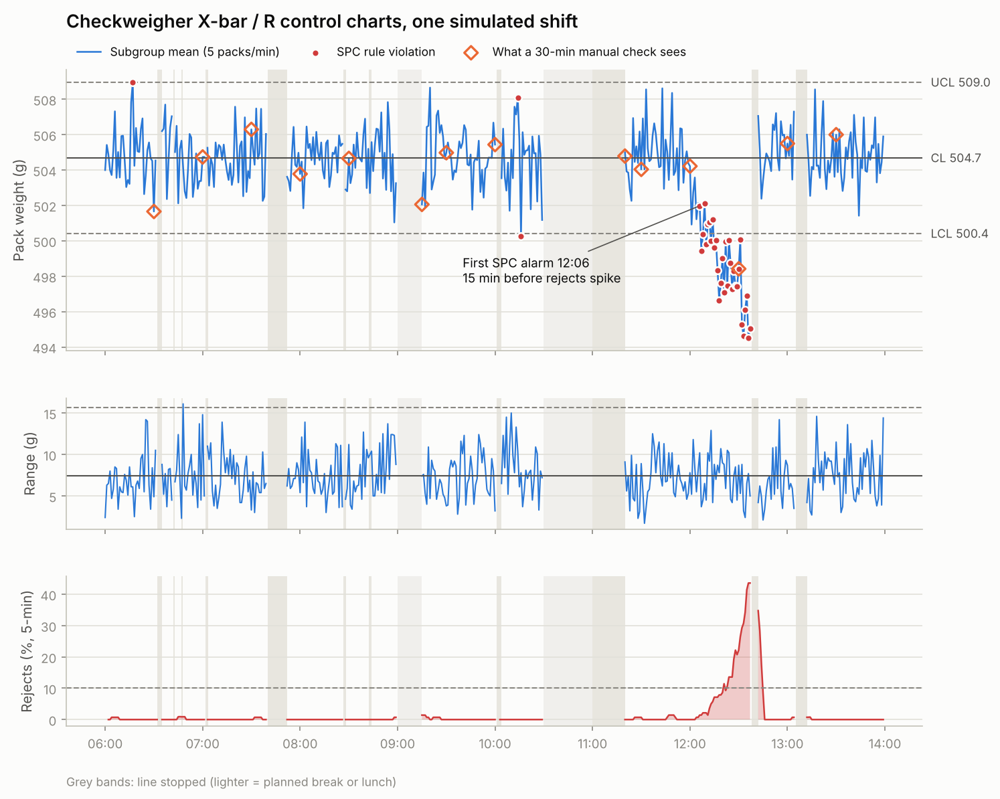

# Packaging line data pipeline: OPC UA → PostgreSQL → SPC & OEE

A small, end-to-end demo of the job of an automation / data-integration specialist on a
food packaging line: get the data off the equipment, store every event reliably, check it
against manual measurements, and turn it into control charts and OEE.

The equipment is **simulated**. Tag names, limits and events are illustrative, not taken
from any real plant or vendor.

```
 ┌──────────────────────────┐   OPC UA     ┌──────────────────┐   SQL    ┌──────────────┐
 │ line_simulator.py        │  subscribe   │ collector.py     │ ───────▶ │ PostgreSQL   │
 │ slicer → thermoformer →  │ ───────────▶ │ buffers changes, │          │ packs,       │
 │ checkweigher, line state │              │ batch inserts,   │          │ line_events, │
 └──────────────────────────┘              │ completeness chk │          │ manual_checks│
                                           └──────────────────┘          └──────┬───────┘
                                                                                │
                                                     analysis.py: SPC, OEE, validation, charts
```

## What one simulated shift contains

8 hours (06:00–14:00) of a line packing 500 g bacon packs at about 28 packs/min
(nameplate 30), compressed to about 4 minutes of real time:

* a 12-minute loader jam, a 20-minute changeover, a thermoformer film break and seven 1–3 minute micro-stops
* a planned break and lunch (excluded from OEE)
* **blade wear**: from 11:50 the slicer slowly drifts 10 g light until rejects climb and it is adjusted at 12:38
* slower running after the film break
* a hidden **+0.8 g calibration offset** in the checkweigher, only visible against QA's manual reference scale

## Results from the included run

| | |
|---|---|
| Packs counted by checkweigher / captured in database | 10,516 / 10,516 (0 missing) |
| Manual checks joined to their packs | 75 of 75 |
| OEE | 79.3% = availability 87.2% × performance 92.4% × quality 98.4% |
| Biggest availability loss | changeover, 20 min |
| First SPC alarm on the drift | 12:06 |
| Rejects pass 10% | 12:21 → **15 min early warning** |
| A 30-min manual check would catch it at | 12:30 |
| Checkweigher bias vs manual scale | +0.71 g (95% CI 0.63 to 0.80 g, n = 75) |
| Giveaway (weight above the 500 g label) | 45 kg in the shift, 4.4 g per pack |



Charts: `output/control_charts.png`, `output/downtime_pareto.png`,
`output/checkweigher_validation.png`. Every number: `output/summary.json`.

## How to run it

Needs Python 3.10+ and PostgreSQL.

```bash
pip install -r requirements.txt
createdb packline                     # or: psql -c "create database packline"
export PG_DSN="host=localhost dbname=packline user=postgres"   # Windows: set PG_DSN=...
python run_demo.py                    # simulator + collector + analysis, ~4 minutes
```

Or in three terminals, which shows the parts better:

```bash
python line_simulator.py   # OPC UA server on opc.tcp://127.0.0.1:4840/packline/
python collector.py        # start within 5 s of the simulator
python analysis.py         # after the shift ends
```

`SIM_SPEED=0.25 python run_demo.py` runs twice as fast. You can browse the live server with
any OPC UA client (for example UaExpert) while the simulator runs.

## How each piece works

**line_simulator.py** builds an OPC UA address space (`Line1/Checkweigher/LastWeight_g`,
`PackCount`, `RejectCount`, `Line1/LineStatus/State`, `StopReason`, `PlannedStop`,
`ShiftComplete`) and writes every value with a **source timestamp**, the time the event
happened on the line, the way a PLC stamps its data. It also writes the QA technician's
manual-check log (`data/manual_checks.csv`), standing in for a paper log that gets typed in.

**collector.py** subscribes to the tags rather than polling them, so it gets every change.
Three details matter on a real line:

* *Every sample, not just changes.* Two consecutive packs can weigh the same to 0.1 g. A
  default OPC UA subscription only reports a value when it changes, so it would silently
  drop the second pack. The collector asks for notifications on value **or** timestamp change.
* *Order across tags isn't guaranteed.* State, stop reason and planned flag arrive as
  separate notifications; the collector joins them on their shared source timestamp.
* *Prove nothing was lost.* At the end of the shift it reads the checkweigher's own
  `PackCount` and compares it with the rows in PostgreSQL (`collection_runs` table).

**sql/analysis_queries.sql** holds the queries: SPC subgroups with a window function,
reject rate per minute, stop durations from consecutive state changes with `lead()`,
giveaway, and the join of manual checks to checkweigher readings.

**analysis.py**

* *X-bar / R chart*: limits from a known-stable baseline (06:00–09:00), Western Electric
  rules (beyond 3σ; 2 of 3 beyond 2σ; 8 in a row on one side). It also replays what a
  30-minute manual check would have seen on the same packs.
* *OEE*: availability = run time / planned time; performance = (packs × ideal cycle time)
  / run time; quality = good packs / all packs. Downtime Pareto by reason.
* *Validation*: paired comparison of checkweigher vs reference scale on the same packs,
  mean bias with a t-based 95% confidence interval.

## Plain-language glossary

* **OPC UA**: standard protocol for reading named values ("tags") from industrial equipment.
* **SPC / control chart**: plot of a process measurement with limits computed from its normal variation; points outside the pattern mean something changed.
* **X-bar / R**: chart of subgroup averages (X-bar) and subgroup ranges (R).
* **OEE**: availability × performance × quality, one number for how well a line runs.
* **Checkweigher**: in-line scale that weighs every pack and rejects underweight ones.
* **Giveaway**: product shipped above the declared weight, which is lost money.
* **Catch-weight**: product priced by its actual weight rather than a fixed nominal one.

## What would change on a real line

* Real tag paths come from each machine's OPC UA server or PLC (some equipment needs
  Modbus or EtherNet/IP instead, or a gateway such as Ignition or Kepware).
* Security: certificates and user authentication on the OPC UA connection (this demo uses none).
* Store-and-forward: buffer to disk when the database is down, so a network blip loses nothing.
* Results flow into the ERP and dashboards rather than PNG files.
* Control limits are re-baselined per product and after any process change.

## Files

```
config.py                 shared settings (limits, rates, connection strings)
line_simulator.py         simulated line, OPC UA server
collector.py              OPC UA client → PostgreSQL
analysis.py               SPC, OEE, validation, charts, summary.json
run_demo.py               runs all three
sql/schema.sql            tables
sql/analysis_queries.sql  queries used by the analysis
data/manual_checks.csv    QA manual-check log from the last run
output/                   charts, summary.json, dashboard_data/
```
